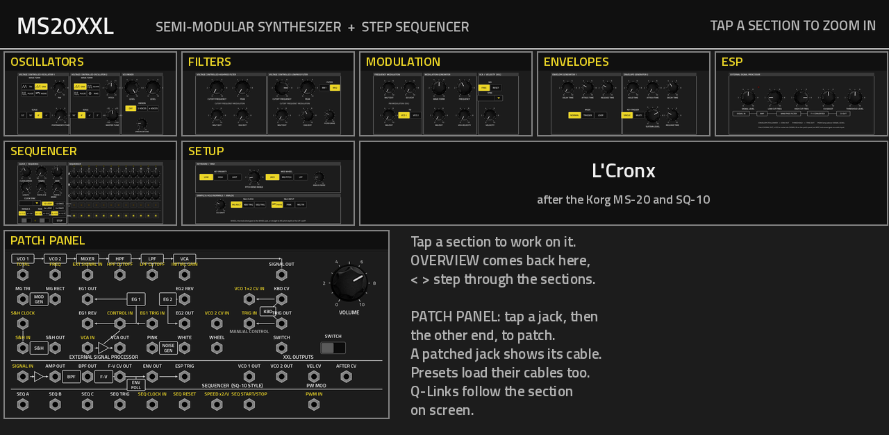
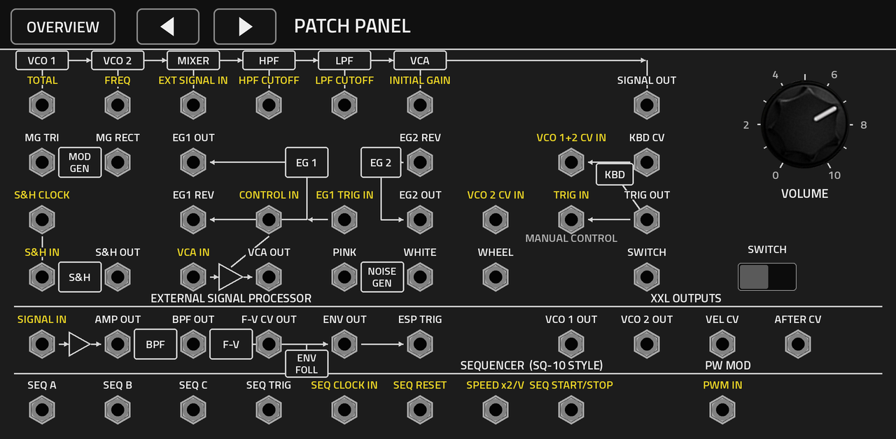

# MS20XXL v0.1.1

**A Korg MS-20-style semi-modular monophonic synthesizer for MPC OS on the Akai Force, circuit-modelled from the
MS-20's schematics, with the whole panel on a tap-to-zoom overview, a patch panel you patch by touch, and an SQ-10-style
analog step sequencer.**

MS20XXL is a VST2 instrument for MPC OS's built-in plugin host, made by L'Cronx. It follows the 1978 Korg MS-20
section for section: two VCOs, the VCO mixer, the highpass and lowpass filters with PEAK, the modulation generator,
the two envelope generators, the VCA, the sample & hold, the noise generator, the modulation VCA, the manual controller,
the external signal processor, and the patch panel with every jack of the original in the original's positions and
normalled the way the panel's hidden wiring normals them. On top of that, the step sequencer of the Korg SQ-10 that
was sold beside it: three channels of twelve steps, 12- or 24-step modes, loop or one-shot, DUTY (gate), swing,
portamento, and its outputs on the patch panel so you patch it into the synth like the real pair.

> [!NOTE]
> **Status: 0.1.1.** 0.1.0 was tested on a Force (MPC OS 3.9.1); 0.1.1 is its panel-layout fix (see the CHANGELOG), built for the Force and not yet re-tested there. First release notes: Passes its engine, host and UI tests on x86 under ASan and UBSan (1625 engine checks:
> every control swept, every one of the 560 cables patched, both filters self-oscillating, Hz/V pitch tracking, the
> sequencer). Not yet checked on a Force: the patching method and the page system are PS3100XXL 0.1.5's, which were.



## The sound: what is modelled, and from what

No Korg code is used. The engine is written from the circuit, and the circuit is what gives the MS-20 its character:

- **The filters.** The MS-20's lowpass is two cascaded OTA one-pole stages with a resonance feedback around them;
  MS20XXL solves that loop per sample without delay (zero-delay feedback) with the same transfer function as the
  circuit, Q = 1 / (2 − K), self-oscillation at K = 2, and the PEAK pot reaching a little past it (K ≈ 2.2), so it howls
  over the last tenth of the knob exactly where the MS-20 does. **MK2** is the late KLM-307 board (LM13600 OTAs): three
  series diodes (~2 V) clip in the feedback path, so only the resonant corner distorts and the pass band stays clean.
  **MK1** is the early KORG35 board: the diode pair sits in the forward gain stage, so every frequency distorts as the
  level grows, the resonance is asymmetric, and the signal itself nudges the cutoff. The highpass is the MS-20's odd one:
  the input enters at the capacitor return, which makes a 12 dB highpass with a 6 dB band pass beside it, the band pass
  winning below the cutoff; that is why an MS-20 HPF thins a sound without ever quite emptying it. Cutoff pots run
  50 Hz–15 kHz, the CUTOFF jacks are 2 oct/V, as Korg specifies.
- **The oscillators.** VCO 1: triangle, sawtooth, pulse (PW from 1:1 to the narrowest), white noise; 32'–4'. VCO 2:
  sawtooth, square, narrow pulse, ring modulator (VCO 1 chopped by VCO 2); 16'–2'; PITCH ±1 octave. Band-limited
  (PolyBLEP, the triangle integrated from a band-limited square as the circuit does), with the slow drift of a
  free-running analog VCO (VCO DRIFT in Setup).
- **Hz/V.** The MS-20's keyboard and VCO CV sockets are linear Hz/V, not V/oct: KBD CV OUT gives 1 V at the keyboard's
  low C and doubles per octave (8 V at the top C). Patching anything into VCO 1+2 CV IN disconnects the keyboard, exactly
  as on the hardware, and a CV there is linear FM (inharmonic, non-musical intervals); TOTAL and FREQ are the exponential
  inputs (1 oct/V with the knob at 10) for musical modulation. The ESP's F-V CV OUT is Hz/V too, so it feeds the VCOs.
- **The envelopes.** EG1 is Delay–Attack–Release, holding at +5 V while the trigger is on. EG2 is Hold–Attack–Decay–
  Sustain–Release, where HOLD keeps the sustain level after the key is released before the release runs. Both have REV
  OUTs (+5 V down to 0). The keyboard is low-note priority, single trigger, as the MS-20's (switchable in Setup).
- **The modulation generator**: 0.1–20 Hz; one WAVE FORM knob leans the triangle from a falling ramp to a rising ramp
  while the rectangle goes from wide to narrow, both outputs on the panel.
- **The panel's voltage laws**: MG triangle ±2.5 V, rectangle 0/+5 V, envelopes 0..+5 V, noise 5 Vpp, gates +5 V,
  VOLUME after a VCA driven by EG2 plus INITIAL GAIN. Every cable carries a voltage and any output can go into any input,
  as on the MS-20 (a gate makes a fine CV; a CV past +2.5 V fires a trigger input).

## How it works on the screen

- **Overview:** the whole instrument on one page. Each section is a tile showing its page in miniature, and the patch
  panel tile shows its sockets. **Tap a tile to zoom into that section.**
- **Zoomed in:** the section fills the screen with large controls in the MS-20's own layout. **OVERVIEW** goes back;
  **<** and **>** step to the neighbouring section.
- **Patch panel:** the MS-20's block diagram with its hex sockets in the original's positions. Tap a socket (an output
  or an input, in either order); the sockets that can take the other end stay lit with a yellow ring, the same side dims;
  tap the other end and the **CONNECTED** page shows the cable. **DONE** keeps it, **UNPLUG** removes it, **CANCEL**
  (top right) drops a half-made patch. One cable per output and per input, like real patch cords: a new cable into an
  input replaces the old one. Tapping a patched socket opens its cable's page. The yellow cables stay drawn on the panel.
- **Pop-up lists** (MG SYNC, CLOCK SYNC): tap the arrow box on the right of the field to open or close the list, then
  tap an option. Tap the value itself to put it on the data wheel and a Q-Link.
- **Q-Links:** the 16 Q-Links follow the section on screen (on the overview: the main sound controls; on the sequencer
  page: clock, swing, gate, length and the twelve knobs of channel A).
- **Presets:** 62 factory patches in MPC's PRESET menu, **cables included**: a patch loads its settings and its cords.
  They include Korg's own "MS-20 Settings Examples" (trumpet, clarinet, oboe, saxophone, flutes, growling bass, the
  arpeggiators, steel drum, comic death tuba, ludicrous harmonica, delayed S&H, bathysphere, monstrous tuned static),
  bass, drum, keyboard, lead and sound-effect patches, and sequencer patches wired like an MS-20 + SQ-10 pair.



## Sections

| Page | Controls |
|---|---|
| OSCILLATORS | VCO 1 wave form / PW / scale, VCO 2 wave form / pitch / scale, VCO 1 and VCO 2 level, portamento, master tune; unison (off, 2, 4 voices) and detune (XXL) |
| FILTERS | HPF cutoff / peak / MG-T.EXT / EG2-EXT, LPF the same; MK1 / MK2 filter board and drive (XXL) |
| MODULATION | frequency modulation MG/T.EXT and EG1/EXT; MG wave form and frequency, free / reset and tempo sync (XXL); PW modulation (XXL); VCA tremolo and velocity to VCA / LPF (XXL) |
| ENVELOPES | EG1 delay / attack / release and mode (normal, trigger, loop); EG2 hold / attack / decay / sustain / release; single / multi key trigger |
| ESP | signal level (PEAK lamp), low cut, high cut, CV adjust, threshold level |
| SEQUENCER | clock speed, clock sync, swing, gate (DUTY), length, mode (12 / 24 steps, loop / once), portamento A/B and C, run, run with transport, STEP, channel ranges, 3 × 12 step knobs, per-step portamento C and trigger buttons, step lamps |
| SETUP | key priority, pitch bend range, mod wheel destination, analog noise, VCO drift, the S&H's unpatched clock and input |
| PATCH PANEL | VOLUME, the manual control switch, and 48 jacks |

The full list of every control and jack with its range and its normalled source is in [docs/INVENTORY.md](docs/INVENTORY.md),
generated from the same file the build checks the skin against.

## The patch panel

**Outputs (28):** MG TRI, MG RECT, EG1 OUT, EG1 REV, EG2 REV, EG2 OUT, KBD CV, TRIG OUT, S&H OUT, VCA OUT, PINK, WHITE,
WHEEL, SWITCH, SIGNAL OUT, the ESP's AMP OUT / BPF OUT / F-V CV OUT / ENV OUT / TRIG, the sequencer's A / B / C / TRIG,
VCO 1 OUT, VCO 2 OUT, VEL CV, AFTER CV.

**Inputs (20):** TOTAL, FREQ, EXT SIGNAL IN, HPF CUTOFF, LPF CUTOFF, INITIAL GAIN, VCO 1+2 CV IN, VCO 2 CV IN,
S&H CLOCK, S&H IN, CONTROL IN, VCA IN, EG1 TRIG IN, TRIG IN, SIGNAL IN (ESP), SEQ CLOCK IN, SEQ RESET, SPEED x2/V,
SEQ START/STOP, PWM IN.

**Normals, as on the MS-20:** the keyboard feeds VCO 1+2 CV IN, TRIG IN and EG1 TRIG IN until something is patched
there. TOTAL replaces the MG at the three MG/T.EXT knobs (pitch, HPF, LPF); FREQ replaces EG1 at the EG1/EXT knob; the
CUTOFF jacks replace EG2 at the EG2/EXT knobs; the modulation VCA is open until CONTROL IN gets a cable; the S&H clocks
from MG RECT and samples white noise until patched (both selectable in Setup).

Some things to try, straight from the Korg settings sheets:
- **Delayed vibrato:** MG TRI → VCA IN, VCA OUT → TOTAL; EG1 delay and attack set the onset (the presets "Clarinet",
  "Flute 1").
- **Arpeggiator:** MG RECT → S&H CLOCK, EG1 OUT → S&H IN, S&H OUT → TOTAL; EG1 attack sets the speed of the climb
  ("Arpeggiate Up"; EG1 REV → S&H IN goes down; EG1 OUT → EG1 TRIG IN makes it self-running).
- **Sequencer:** SEQ A → TOTAL (channel A at ±1 V = ±1 octave, 12 semitones per volt), SEQ TRIG → TRIG IN, SEQ B →
  LPF CUTOFF for per-step timbre, SEQ C → INITIAL GAIN for accents, WHITE → SPEED x2/V for a drunk clock. RUN starts
  it, WITH TRANSPORT runs it with the Force's play button, STEP steps it by hand while stopped.
- **The ESP on the synth itself:** SIGNAL OUT → SIGNAL IN, ENV OUT → INITIAL GAIN or a CUTOFF, ESP TRIG → TRIG IN;
  an MPC instrument plugin receives no audio input, so the ESP processes what you patch into it (noise, a VCO, the
  output; "Monstrous Tuned Static" is the feedback patch).

## Install

Download the zip from Releases and follow its `INSTALL.md` (the installer stops and restarts MPC).

## Build

```
git clone --recurse-submodules https://github.com/sunskiefer/MS20XXL
cd MS20XXL
pip install pillow numpy ziglang
./build.sh            # -> build/package/L'Cronx - VST - MS20XXL  (skin + ms20xxl.so), previews in build/preview
bash test/run_tests.sh
```

`tools/spec.py` is the one source of truth for every control, jack and position; `tools/gen_params.py` writes
`params.json`, `src/param_ids.h`, `layout.conf`, `docs/INVENTORY.md` and `presets.json` (from `tools/presets.py`) from it,
`tools/post_skin.py` paints the panel and `tools/check_skin.py` checks the built skin against the inventory. The
wrapper is sunskiefer/mpc-vst-plugins at its `lcronx-release-quoting` branch (the escaped `release.py` /
`catalog_check.py` and the Q-Link UpdateDisplay fix), pinned as a submodule.

## Credits and licence

GPL-3.0-or-later, (c) L'Cronx. The knob pictures are LXRXXL BAZZLINE's. Titillium Web (OFL). Built on
[mpc-vst-plugins](https://github.com/sd88me/mpc-vst-plugins) (the VST2 wrapper, skin generator and release tools). The
MS-20 and SQ-10 circuits are documented in Korg's service manuals and in Tim Stinchcombe's MS-20 filter study; the
factory settings 1–17 are Korg's own "MS-20 Settings Examples", transcribed by nbirnel/korg-ms-20-patches. Korg, MS-20
and SQ-10 are trademarks of Korg Inc.; MS20XXL is not made or endorsed by Korg.
