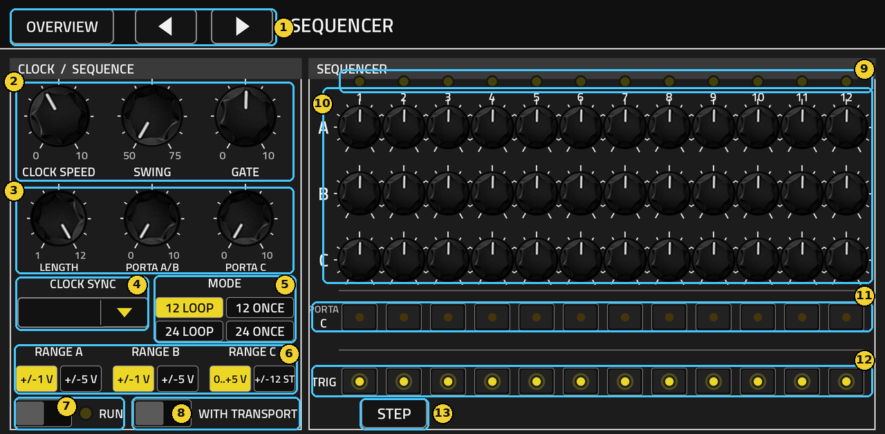
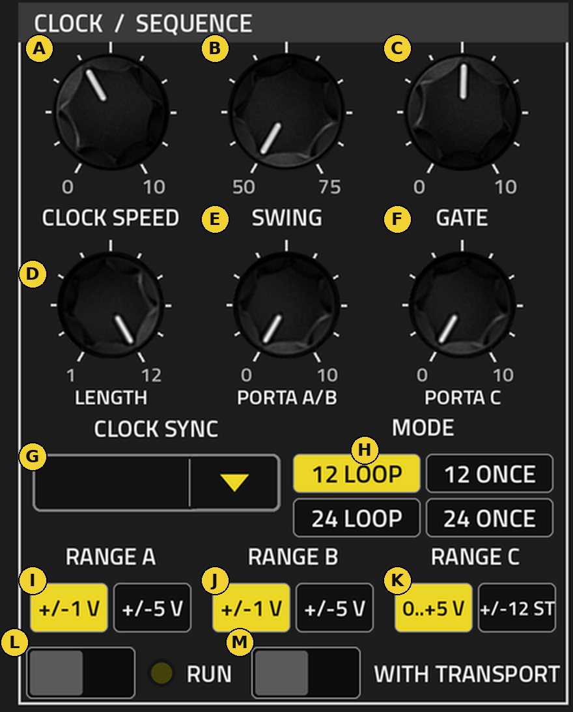
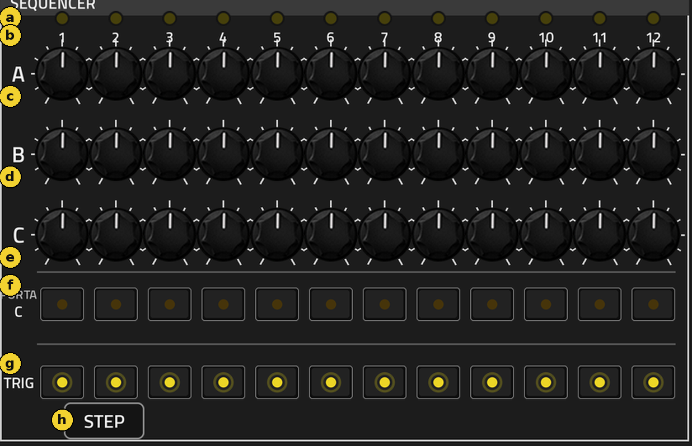
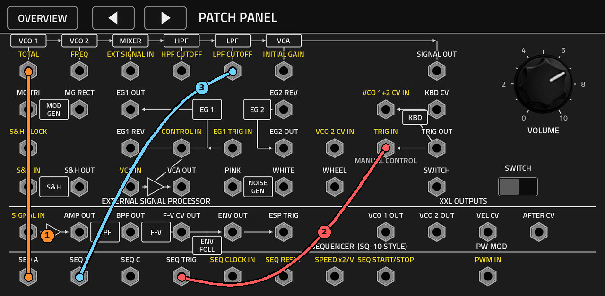
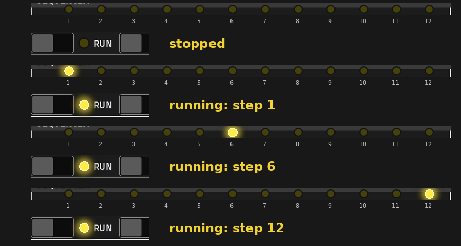
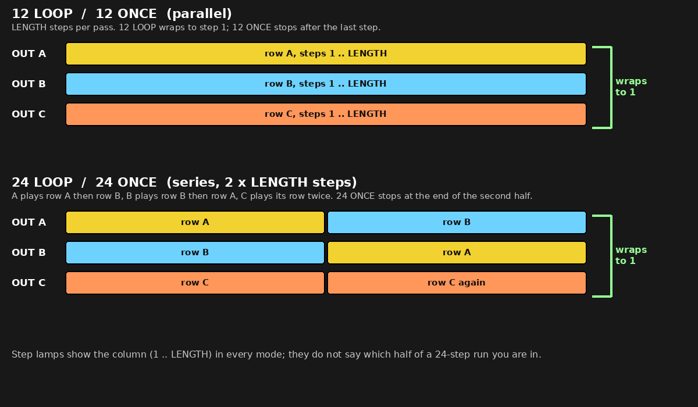
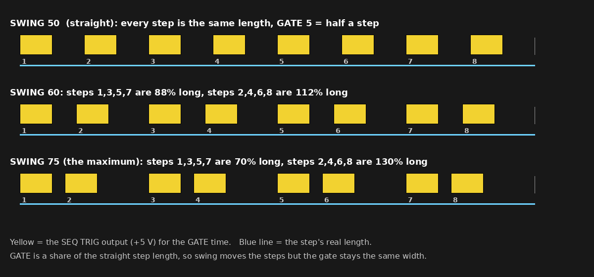

# MS20XXL sequencer manual

The SQ-10-style sequencer page of MS20XXL 0.1.1. It runs the moment you switch RUN on, with no cables needed; the lamps step along the top row while it runs. Written from the plugin's source and panel.

## Quick start

1. On the overview, tap the SEQUENCER tile. The page in figure 1 opens.
2. Switch **RUN** on (control 7). The small lamp beside RUN lights and the 12 step lamps (9) start to walk left to right. That is the whole "it is running" signal.
3. To hear it, make three cords on the patch panel (see "Patching"): SEQ A to TOTAL, SEQ TRIG to TRIG IN, SEQ B to LPF CUTOFF. Then, on the MODULATION page, turn the frequency-modulation MG/T.EXT knob up to 10 so TOTAL actually moves the pitch.
4. Fastest route: load the factory patch **SQ-10 Self-Running**. It loads its three cords, has RUN on and WITH TRANSPORT off, so it plays by itself with no key and no Force play button.

*Figure 1.* Not yet confirmed on a Force: 0.1.0 was tested there, but the on-device checklist in [TESTING.md](TESTING.md) still has the sequencer checks (RUN, lamps, transport, clock sync) unticked. Everything below is what the code does.

## The page at a glance

| # | Area | What it is for |
|---|---|---|
| 1 | Header: OVERVIEW, < and > | OVERVIEW returns to the tiles; < and > step to the neighbouring section. The name and value of any control you touch show at the top right. |
| 2 | CLOCK SPEED, SWING, GATE | How fast it steps, how uneven the steps are, how long each trigger lasts |
| 3 | LENGTH, PORTA A/B, PORTA C | How many steps play, and how smoothly the outputs glide between steps |
| 4 | CLOCK SYNC | Free-running speed, or locked to the Force tempo |
| 5 | MODE | 12 or 24 steps, looping or one pass |
| 6 | RANGE A, B, C | The voltage span of each output |
| 7 | RUN + lamp | Starts and stops it; the lamp is lit while it runs |
| 8 | WITH TRANSPORT | Lets the Force play button start and stop it |
| 9 | Step lamps 1 to 12 | Show which step is playing, only while it runs |
| 10 | Knob rows A, B, C | The 36 step values, -5 to +5 |
| 11 | PORTA C buttons | Per step: glide channel C into this step |
| 12 | TRIG buttons | Per step: send a trigger on SEQ TRIG |
| 13 | STEP | Advances one step by hand while stopped |

The 16 Q-Links follow this page: clock speed, swing, gate, length, then the twelve channel-A knobs. Three outputs (A, B, C) and one trigger (TRIG) leave the sequencer, and they are only heard once you patch them.

## Every control, part by part

### Left side: clock and sequence rules

Circle knobs turn in place; drag or use the data wheel. Letters match figure 2.

*Figure 2.*

| Letter | Control | Range, default | What it does |
|---|---|---|---|
| A | CLOCK SPEED (knob) | 0 to 10, default 4 | Free-running step rate, from about 0.1 steps a second (10 s a step) at 0 to about 59 a second at 10; 5 is about 2.4 a second. Ignored while CLOCK SYNC is not Free. |
| B | SWING (knob) | 50 to 75 %, default 50 | 50 is straight. Higher makes steps 1, 3, 5.. shorter and 2, 4, 6.. longer; at 75 they run 70 % and 130 % (figure 8). |
| C | GATE (knob) | 0 to 10, default 5 | Length of the SEQ TRIG pulse as a share of one step: 5 is half a step, 10 is the whole step. Never shorter than 4 ms. |
| D | LENGTH (knob) | 1 to 12, default 12 | Steps played per pass. In the 24-step modes it applies to each row, so 24 modes play 2 x LENGTH steps. |
| E | PORTA A/B (knob) | 0 to 10, default 0 | One glide time shared by outputs A and B. 0 jumps straight to the new value. |
| F | PORTA C (knob) | 0 to 10, default 0 | Glide time for output C, used only on steps whose PORTA C button is on. |
| G | CLOCK SYNC (pop-up) | Free, 1/1, 1/2, 1/4, 1/8, 1/16, 1/32, 1/4 T, 1/8 T, 1/16 T, 1/8 dotted, 1/16 dotted | Free uses CLOCK SPEED. Any note value makes every step that long at the Force tempo. Tap the arrow box to open the list, tap an option; tap the value itself to put it on the data wheel and a Q-Link. |
| H | MODE (4 buttons) | 12 LOOP default | See "Every mode explained". |
| I | RANGE A | +/-1 V or +/-5 V, default +/-1 V | Voltage span of output A: knob -5..+5 becomes -1..+1 V, or the full -5..+5 V. |
| J | RANGE B | same | Same for output B. |
| K | RANGE C | 0..+5 V or +/-12 ST, default 0..+5 V | Output C either as a 0 to 5 V level (accent, filter, gain) or as +/-1 V for pitch (+/-12 semitones at 1 V per octave). |
| L | RUN (switch + lamp) | Off / On, default Off | On starts the sequencer from step 1. The lamp beside it is lit while it is really running. |
| M | WITH TRANSPORT (switch) | Off / On, default Off | On lets the Force play and stop run the sequencer. |

How knob values turn into notes: with RANGE A at +/-1 V and the pitch MG/T.EXT knob at 10, 5 on a step knob is one octave, so 0.42 is one semitone, 1.25 is three, 2.5 is six, 5 is twelve. Fine values are easiest on the data wheel.

### Right side: the step grid

Letters match figure 3.

*Figure 3.*

| Letter | Control | Range, default | What it does |
|---|---|---|---|
| a | Step lamps | lit while running | One lamp per step 1 to 12. The lit one is the step playing now. |
| b | Step numbers 1 to 12 | none | Labels; every column below shares a number. |
| c | Row A, 12 knobs | -5 to +5, default 0 | Value sent to SEQ A on that step (scaled by RANGE A). |
| d | Row B, 12 knobs | -5 to +5, default 0 | Value sent to SEQ B on that step (scaled by RANGE B). |
| e | Row C, 12 knobs | -5 to +5, default 0 | Value sent to SEQ C on that step (scaled by RANGE C). |
| f | PORTA C, 12 buttons | Off, default | On: output C glides into this step using the PORTA C time. Off: C jumps. |
| g | TRIG, 12 buttons | On, default | On: this step fires a pulse on SEQ TRIG. Off: the step still moves A, B and C but sends no pulse, so an envelope fed by SEQ TRIG does not retrigger. Use it for rests. |
| h | STEP (button) | push | While stopped, advances one step and fires it, once per press. Does nothing while running. |

## Patching the sequencer to run and play

The sequencer's eight sockets sit on the bottom row of the PATCH PANEL page. Orange rings are outputs, blue rings are inputs (figure 4).

*Figure 4.*

| # | Socket | Direction | What it carries |
|---|---|---|---|
| 1 | SEQ A | out | Channel A, scaled by RANGE A |
| 2 | SEQ B | out | Channel B, scaled by RANGE B |
| 3 | SEQ C | out | Channel C, scaled by RANGE C |
| 4 | SEQ TRIG | out | +5 V pulse for the GATE time on every step whose TRIG button is on |
| 5 | SEQ CLOCK IN | in | An outside clock. Each rising edge steps once and the internal clock stops. |
| 6 | SEQ RESET | in | A rising edge restarts at step 1 |
| 7 | SPEED x2/V | in | Clock speed: each +1 V doubles the rate, -1 V halves it (limited to +/-5 V) |
| 8 | SEQ START/STOP | in | Each rising edge flips RUN on or off |

### How to patch a cord

1. Tap the socket at one end, output or input, in either order. Sockets that can take the other end keep a yellow ring; the same kind dims.
2. Tap the other end. The CONNECTED page shows the cord.
3. DONE keeps it. UNPLUG removes it. CANCEL (top right) drops a half-made patch.
4. One cord per output and per input. A new cord into an input replaces the old one. Tap a patched socket to reopen its cord's page.

### The patch that makes it play

*Figure 5.*

| Cord | From to | Why |
|---|---|---|
| 1 | SEQ A to TOTAL | Channel A becomes the pitch. TOTAL replaces the modulation generator at the pitch MG/T.EXT knob, so set that knob (MODULATION page, frequency modulation MG/T.EXT) to 10; the factory sequencer patches all do. |
| 2 | SEQ TRIG to TRIG IN | Each step fires both envelopes, replacing the keyboard trigger. No key needs to be held. |
| 3 | SEQ B to LPF CUTOFF | Channel B moves the lowpass cutoff per step. It acts at the LPF EG2/EXT knob, so turn that knob up to hear it. |

Other useful cords: SEQ C to INITIAL GAIN for accents, SEQ C to HPF CUTOFF, WHITE to SPEED x2/V for a drunk clock, SEQ TRIG to S&H CLOCK, and SEQ START/STOP and SEQ RESET fed from the MG rectangle or an envelope to start, stop and restart on a beat.

### Clock cords: read this before patching SEQ CLOCK IN

While anything is patched into SEQ CLOCK IN, the internal clock is off and CLOCK SPEED, CLOCK SYNC and SWING do nothing. The sequencer then steps only when a rising edge arrives. If the cord's source is silent, RUN and the lamp can be on while the step lamp sits on step 1 and nothing moves. Unplug the cord to get the internal clock back.

### Making the LEDs show it is running

Both kinds of lamp (the step lamps and the RUN lamp) are driven by one thing: the sequencer really running.

1. Be on the SEQUENCER page. The step lamps are drawn only there.
2. Start it by one of three routes: RUN on, or WITH TRANSPORT on and the Force playing, or a pulse into SEQ START/STOP.
3. Check there is no dead cord in SEQ CLOCK IN.
4. Watch the lamps (figure 6): all dark when stopped; once running, the RUN lamp is lit and one step lamp is lit at a time, moving 1, 2, 3 .. up to LENGTH.

*Figure 6.* The lit lamps are painted onto the real panel as an illustration.

If the lamps stay dark: the sequencer is not running (RUN off, or WITH TRANSPORT on but the Force is stopped), a one-shot mode has finished, or you are on another page. Pressing STEP while stopped fires the step but does not light the lamps, because they follow running only.

## Every mode explained

### Sequence modes (MODE buttons)

*Figure 7.*

| Mode | Steps played | At the end | Lamps and RUN lamp |
|---|---|---|---|
| 12 LOOP (default) | 1 to LENGTH, each row on its own output | Wraps to step 1 and keeps going | Lamp 1 to LENGTH, repeating. Lamps above LENGTH never light. RUN lamp stays lit. |
| 12 ONCE | 1 to LENGTH, once | Stops after the last step | Lamps go dark, and the RUN lamp goes dark, even though the RUN switch still reads On. |
| 24 LOOP | Row A then row B on output A; row B then row A on output B; row C twice on output C. 2 x LENGTH steps | Wraps to the start | Lamps run 1 to LENGTH twice per cycle; they do not show which half you are in. |
| 24 ONCE | Same 24-step run, once | Stops after the second half | Same as 12 ONCE. |

Restarting a one-shot: switch RUN off and on again, or press Force play again when WITH TRANSPORT is on, or send a pulse to SEQ RESET while RUN or the transport still asks for it.

### Start modes

| Mode | How | Lamps |
|---|---|---|
| RUN | RUN switch On. Starts at step 1. | RUN lamp and one step lamp light. |
| WITH TRANSPORT | Switch On, then Force play starts it (back at step 1, one-shots re-armed) and Force stop stops it. RUN can still be on at the same time; either one keeps it going. | Lamps follow the Force play state. |
| START/STOP jack | Each rising edge into SEQ START/STOP flips the RUN switch. | Same as RUN. |
| STEP button | Only while stopped; one press, one step, fires that step's trigger. | None: lamps follow running only. |

### Clock modes

| Mode | How to get it | Notes |
|---|---|---|
| Free | CLOCK SYNC on Free | CLOCK SPEED sets the rate; SPEED x2/V can speed it up or slow it down |
| Synced | CLOCK SYNC on any note value | One step per note value at the Force tempo, so a tempo change moves the speed; CLOCK SPEED is ignored |
| External | Cable into SEQ CLOCK IN | One step per rising edge; internal clock and swing off |

Swing stretches alternate steps while keeping each pair the same total length, and the trigger length is set from the straight step so GATE stays constant (figure 8).

*Figure 8.*

### Output range modes

| Output | Setting | Result |
|---|---|---|
| A and B | +/-1 V | Knob -5 to +5 gives -1 to +1 V. For pitch into TOTAL at 10, that is plus or minus one octave. |
| A and B | +/-5 V | Raw -5 to +5 V. Wide CV sweeps for filter cutoff. |
| C | 0..+5 V | Knob -5 to +5 gives 0 to 5 V, centre 2.5 V. For accents, gain and cutoff. |
| C | +/-12 ST | Knob -5 to +5 gives -1 to +1 V, a second melodic line. |

### Per-step modes

| Control | Off | On |
|---|---|---|
| TRIG | The step moves A, B and C but sends no trigger: a rest | Sends a trigger of GATE length |
| PORTA C | Output C jumps to the step value | Output C glides in at the PORTA C time |

## Factory sequencer patches to learn from

| Patch | Settings worth looking at | Cords |
|---|---|---|
| SQ-10 Self-Running | RUN on, WITH TRANSPORT off, speed 5.5, gate 4, length 8, A steps 0 0 1.5 0 -1.5 0 2.5 3 | SEQ A to TOTAL, SEQ TRIG to TRIG IN, SEQ B to LPF CUTOFF |
| SQ-10 Bassline | Same line, WITH TRANSPORT on, so Force play runs it | same three |
| SQ-10 Arpeggio | CLOCK SYNC on 1/16, length 8, A rises then falls | SEQ A to TOTAL, SEQ TRIG to TRIG IN |
| SQ-10 Twenty-Four | MODE 24 LOOP, channel C used as a 0..+5 V level | A to TOTAL, TRIG to TRIG IN, SEQ C to HPF CUTOFF |
| SQ-10 Drone Mod | PORTA A/B 6, gate 10, RANGE A +/-5 V, speed 3 | SEQ A to LPF CUTOFF, SEQ B to HPF CUTOFF |
| SQ-10 Random Clock | A noise cord makes the speed wander | WHITE to SPEED x2/V, plus the usual three |
| SQ-10 S&H Clocked | The sequencer trigger clocks the sample and hold | SEQ TRIG to S&H CLOCK, WHITE to S&H IN, S&H OUT to TOTAL, SEQ C to LPF CUTOFF |

## If something is wrong

| You see | Likely cause | Fix |
|---|---|---|
| No lamps, RUN lamp dark | Not running, or you are on another page | Open the SEQUENCER page; switch RUN on, or turn WITH TRANSPORT on and press Force play |
| RUN switch On, lamps dark | A ONCE mode finished | Switch RUN off and on, or pulse SEQ RESET |
| RUN lamp lit, lamp stuck on step 1 | A cord sits in SEQ CLOCK IN with no clock arriving | Unplug it or feed it a clock |
| Lamps move, no sound | SEQ TRIG not patched to TRIG IN, or SEQ A not in TOTAL with the pitch MG/T.EXT knob at 0 | Patch as above and turn that knob to 10 |
| Notes the same height every step | Channel A knobs all at 0, or RANGE A too small | Move the A knobs; try +/-5 V for wider jumps |
| Notes retrigger when you wanted a tie | TRIG is on for that step | Switch that step's TRIG off |
| CLOCK SPEED does nothing | CLOCK SYNC is not Free | Set CLOCK SYNC to Free |
| Steps beyond a number never play | LENGTH is lower than 12 | Raise LENGTH |

Sources in this repo: [README.md](README.md), [docs/INVENTORY.md](docs/INVENTORY.md), `src/ms20_dsp.h` (the sequencer), `src/engine.cc`, `tools/presets.py`.
